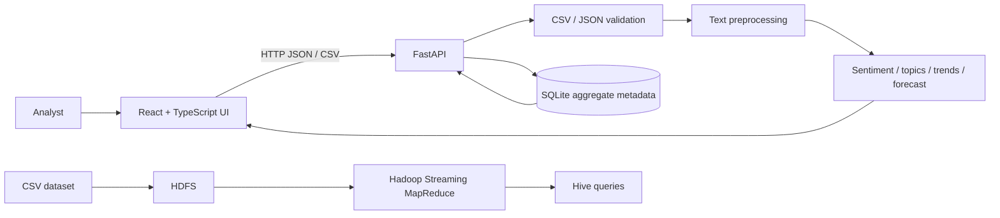

# SocialPulse AI — academic report scaffold

## Abstract

SocialPulse AI is a local-first prototype for exploring social-media-style text.
Its React/TypeScript dashboard automatically loads an explicitly synthetic
first-run demo and also supports optional CSV analysis. It validates CSV data,
supports CSV/JSON imports, applies a transparent lexicon sentiment baseline,
suggests topics with TF-IDF/NMF and evidence, compares post-level keyword counts
across configurable adjacent windows, and offers a daily Holt/naive forecast.
A FastAPI service and
Streamlit client are separate processes. Hadoop Streaming and Hive assets support
a separate distributed-processing demonstration. Results depend on the supplied
dataset and must not be interpreted as ground truth.

## Problem, motivation, and objectives

Organizations receive text across platforms, but manually reviewing every post
does not scale. The project demonstrates ingestion, text analytics, time-based
aggregation, and an explainable interface while making limitations visible.
Objectives are to validate tabular posts; calculate baseline sentiment; surface
topics and volume changes; visualize and export observed results; and demonstrate
the Hadoop/HDFS/MapReduce/Hive workflow separately.

## Existing and proposed systems

Manual review and isolated charts can be difficult to repeat and compare.
SocialPulse provides a reproducible local pipeline and an optional Hadoop job.
It is a teaching prototype, not a production monitoring service, and it does not
claim access to private or live platform APIs.

## Scope and requirements

Functional scope: CSV/JSON upload and column mapping; text cleaning; sentiment,
keyword, topic, trend, and forecast summaries; brand text matching; download;
API endpoints; SQLite aggregate history; and Big Data job examples.

Non-functional goals: bounded upload/row/text sizes; explicit validation errors;
no raw-text persistence; deterministic topic seed; configurable CORS; readable
modules; and clear separation between local and distributed execution.

## Architecture and data flow

Use-case diagram: a student opens the dashboard to inspect the generated demo,
explores sentiment/topics/trends, optionally forecasts a keyword, filters and
exports records, evaluates against optional labeled data, and separately
executes MapReduce/Hive in an installed cluster. CSV import remains optional.

## Database design

SQLAlchemy manages the `analyses(id, created_at, total_posts, positive_count,
neutral_count, negative_count, analysis_mode)` SQLite table. It stores aggregate
metadata only; uploaded post text is processed in memory and not written to
this database.

## API

- `GET /health`
- `POST /predict/sentiment` — JSON `{ "text": "..." }`
- `POST /analyze/dataset` — multipart CSV and optional column names
- `POST /analyze/import` — multipart CSV or JSON and optional column names
- `POST /analyze/topics` — texts and optional sentiment labels
- `POST /analyze/trends` — records, window size, and minimum mentions
- `POST /evaluate/sentiment` — multipart labeled CSV with text and reference labels
- `POST /forecast` — dated counts and horizon
- `GET /analytics/summary`, `GET /analytics/history`

Interactive schema documentation is served at `/docs` while the backend runs.

## Methodology and algorithms

Preprocessing lowercases text, strips URLs/mentions, preserves hashtag terms,
and tokenizes with a regular expression. The sentiment baseline counts words in
small documented positive/negative lexicons; it is not a trained or calibrated
classifier. TF-IDF and seeded non-negative matrix factorization (NMF) provide
topic suggestions when there is enough varied text. Each topic includes
assigned representative posts, sentiment counts, and a UMass top-term
co-occurrence measure; the measure is not a ground-truth quality score.
Trend detection counts a term once per post in equal calendar-day windows,
requires a configurable current-period minimum, ranks results using
`log(1 + current mentions) × absolute change / max(previous mentions, 1)`, and
withholds percentage growth below a previous-count threshold. No significance
test is asserted. Daily forecasting requires at least 14 periods, fills gaps
inside the observed span with zero, and compares a last-value baseline with
fixed-parameter Holt damped-trend smoothing. Model selection uses an earlier
chronological validation split within the training segment; the final metrics
come from a later outer holdout. MAE and RMSE are series-specific. Error bands
are empirical and omitted unless at least ten outer holdout errors exist; they
are not calibrated confidence intervals.

HDFS stores files in blocks across DataNodes under NameNode metadata.
MapReduce distributes mapper work, sorts/shuffles key-value output, then reduces
groups. Streaming examples count words and hashtags and aggregate pre-labeled
sentiment by date and topic; they do not generate sentiment labels. The optional
PySpark job produces word/hashtag frequencies and applies the documented
lexicon baseline for sentiment aggregation. Hive provides SQL-like aggregation
over data in HDFS. The dashboard's
Pandas/scikit-learn path is single-machine processing and must not be described
as distributed.

## Evaluation and results

No benchmark result is pre-filled. The built-in sentiment rules do not produce
accuracy, precision, recall, F1, or a confusion matrix without independent
labeled ground truth. For a defensible experiment: identify a licensed labeled
dataset; document label mapping and exclusions; split train/test before tuning;
report per-class precision/recall/F1 and confusion matrix; record package,
dataset, and random-seed versions. Forecast MAE/RMSE is only a small
time-ordered holdout on the uploaded series. Record actual run outputs here
after performing and documenting an experiment.

## Limitations, future work, conclusion

Sarcasm, slang, multilingual posts, class imbalance, lexicon coverage, bot
activity, changing platform populations, ambiguous brand references, missing
timestamps, and short history can mislead analyses. Topic labels are suggestions.
Future work includes licensed pretrained models, labeled evaluation, incremental
processing, alert review, privacy controls, richer temporal models, and a tested
cluster deployment. The prototype demonstrates an end-to-end analytics workflow
but does not establish causal explanations or durable trends.

## Dataset and reference policy

The bundled `data/sample/socialpulse_sample.csv` is synthetic and explicitly
for tests/demo only. For real data, select a dataset from its original
publisher/repository, read the current license and platform terms, document
version/date/attribution/columns/size, and avoid collecting unnecessary
identifiers. Suitable discovery starting points include the UCI Machine
Learning Repository and Hugging Face Datasets; verify each chosen dataset's
license and provenance before use. Do not present reviews as social posts or
claim measured dataset sizes without checking the source.

See [DATASETS.md](./DATASETS.md) for specific source pages, known shape caveats,
and the reproducible acquisition checklist.

## Demonstration checklist

1. Start the API and dashboard using the README commands.
2. Upload the synthetic sample and map text/timestamp/platform.
3. Review validation counts, sentiment, keywords, topics, and timestamp trends.
4. Search/filter and export processed rows.
5. Submit a single post and inspect the baseline response in API `/docs`.
6. Run tests and the local word-count smoke test.
7. Explain that local smoke testing is not a Hadoop cluster execution.

## Likely viva questions

1. **What is sentiment analysis?** Assigning sentiment labels/scores to text;
   here it is a transparent lexicon baseline.
2. **Why not claim high accuracy?** There is no independent labeled evaluation.
3. **What is TF-IDF?** A weighting scheme that emphasizes informative terms
   relative to a document collection.
4. **What does LDA do?** It estimates document-topic and topic-word mixtures;
   labels still need human interpretation.
5. **How is a trend detected?** Keyword counts in equal current and prior
   windows, minimum counts, and guarded growth percentages.
6. **Why is a forecast uncertain?** Short/noisy history and a simple baseline
   cannot capture platform or external changes.
7. **What is HDFS?** Hadoop's distributed file system, which stores file blocks.
8. **What is MapReduce?** Parallel map, shuffle/sort, and reduce stages.
9. **What is Hive?** A SQL-like query layer for data stored in Hadoop systems.
10. **Is Pandas distributed?** No; this project's dashboard analytics are local.

## Resume and repository description

**Resume:** Built SocialPulse AI, a FastAPI + Streamlit social-text analytics
prototype with CSV validation, sentiment baseline, topic suggestions, guarded
trend analysis, forecasting evaluation, SQLite aggregate history, and Hadoop
Streaming/Hive examples.

**GitHub description:** Explainable, local-first social media text analytics
with FastAPI, Streamlit, NLP baselines, trend exploration, and Hadoop examples.
